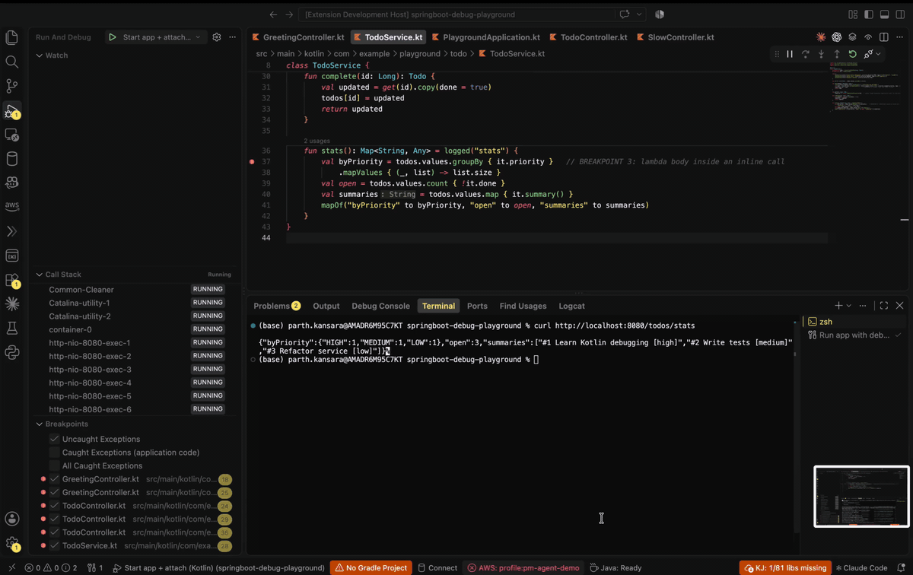

# Kotlin Debugger for VS Code

Debug Kotlin/JVM and Spring Boot applications in VS Code. Attach over JDWP, set breakpoints in `.kt` files, and inspect your application in Kotlin terms.



## Features

- Attach to a running JVM or launch a main class.
- Kotlin source breakpoints, including inline functions and coroutines.
- Kotlin-aware stepping, call stacks, variables, and expression evaluation.
- Kotlin completion and parameter hints.

## Install

Install **Kotlin Debugger** from the VS Code Extensions view, or run:

```sh
code --install-extension kparth01.kotlin-debugger
```

The adapter requires a full JDK 17 or newer. To build and install from source, you also need Maven 3.9+ and Node.js 18+:

```sh
./scripts/build.sh
code --install-extension dist/kotlin-debugger-*.vsix
```

## Quick start

1. Start your app with JDWP enabled. For a local-only connection, add this JVM argument:

   ```text
   -agentlib:jdwp=transport=dt_socket,server=y,suspend=n,address=127.0.0.1:5005
   ```

2. Add an attach configuration to `.vscode/launch.json`:

   ```json
   {
     "version": "0.2.0",
     "configurations": [
       {
         "type": "kotlin-jvm",
         "request": "attach",
         "name": "Attach to Kotlin JVM",
         "hostName": "localhost",
         "port": 5005
       }
     ]
   }
   ```

3. Choose **Attach to Kotlin JVM**, press F5, and set breakpoints in your Kotlin source.

The debugger searches the workspace for sources by default. Set `projectRoot` or `sourcePaths` if your Kotlin sources are elsewhere. You can also attach using **Kotlin Debugger: Attach to JVM (host:port)…** without creating a launch configuration.

> JDWP provides full control of the JVM. Keep the debug port private; use a local bind, SSH tunnel, or port-forward for remote apps.

## Requirements

- VS Code 1.85 or newer
- JDK 17+ to run the debugger adapter
- Any JVM with JDWP enabled (JDK 21 tested)

## Development

Run the complete test suite with `./scripts/test.sh`. See [docs/ARCHITECTURE.md](docs/ARCHITECTURE.md) for implementation details and [extension/README.md](extension/README.md) for Marketplace installation information.

## License

This project is licensed under the [MIT License](LICENSE). Copyright © 2026 Parth Kansara.